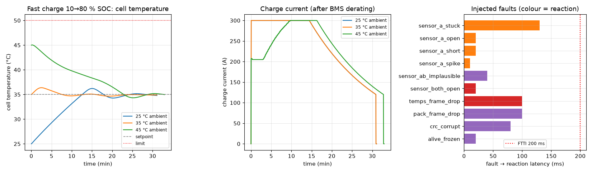

# Battery fast-charge thermal controller, tested in the loop

This is a thermal controller for a traction battery during DC fast charge, written in C11 on FreeRTOS and run against a simulated pack over CAN, with no hardware anywhere. I inject ten kinds of fault, from an open sensor to a frozen alive counter, and the slowest reaction is 130 ms (a stuck sensor) against a 200 ms budget. Charges without faults stay well under the 50 °C cell limit and never set a fault flag.

I wanted to find out how much of an ECU you can check before there's a bench to put it on, as long as you keep the parts a real one has: a DBC file, an RTOS, and E2E protection on every CAN message.



At 25 and 35 °C ambient the controller never leaves NORMAL. Starting with a pack already soaked at 45 °C is different. It derates to about 205 A until the chiller brings the cells back to the 35 °C setpoint, which takes 1205 s, and the 10 to 80 % charge stretches from 30.9 to 32.8 minutes. The full tables are in [docs/results.md](docs/results.md).

## What the simulation caught

All three of these bugs passed the unit tests.

My first E2E check kept one error counter shared by every message. Good `PackStatus` frames kept pulling it back down, so `CellTemps` could lose half its frames to CRC errors and the counter never reached its limit. Each message has its own counter now.

Comparing my C CAN codec against cantools showed the step counter coming out wrong. It's 32 bits wide, and the physical-value encoder passed it through a `float`, which can't hold every 32-bit integer.

An open sensor reads 369.5 °C. The range check waits for three bad samples before flagging anything, but the first one had already gone into the filter, and that was enough to trip overtemperature and send the pack to SAFE_STATE. Now a sample that fails the range or rate check is dropped on arrival, and only the fault flag waits for the debounce.

## Running it

```bash
python3 -m venv .venv && .venv/bin/pip install -r requirements.txt
make -C firmware test                       # Unity unit tests + branch coverage
.venv/bin/python scripts/run_scenarios.py   # fast-charge + fault SIL runs -> docs/results.md, docs/sil_results.png
python3 -m pytest sil -q                    # builds bms_app, runs 3 fast charges + 10 fault scenarios (~1 min)
```

If a `vcan0` interface exists the SIL suite uses it, otherwise it falls back to a Unix socketpair. pytest tells you which. To get vcan:

```bash
sudo modprobe vcan && sudo ip link add dev vcan0 type vcan && sudo ip link set up vcan0
```

The `bms_app` flags, the transport override and the plant parameters are in [docs/sil-harness.md](docs/sil-harness.md).

## Inside

The controller is a plain C library in `firmware/src/`. No RTOS calls, no malloc. It handles sensor fault detection, a four-state machine (NORMAL, DERATE, LIMP, SAFE_STATE), PI control of the pump and chiller, and a temperature-to-current derate map with hysteresis. Since it doesn't need FreeRTOS, the Unity tests call it directly, and `make -C firmware test` fails if branch coverage for any single module falls under 80 %.

The FreeRTOS app around it has three statically allocated tasks: one shuffling CAN frames, a 10 ms control task, and a 100 ms diagnostics task that doubles as a watchdog. The other end is a Python plant with a cell mass, a coolant mass, a chiller, a fast charger that tapers its current, and the fault injector.

The two sides don't share a clock. Every simulated 10 ms the plant sends a `SIL_Sync` frame, and the firmware runs one control cycle and then waits for the next one. Runs come out identical every time, and a whole charge simulates in about 20 s.

How the tests are laid out, coverage per module and the requirement-to-test mapping are in [docs/testing.md](docs/testing.md). The safety goals are in [docs/safety_requirements.md](docs/safety_requirements.md).

## Still missing

- Every result in `docs/` came over the socketpair, since the machine I used has no `vcan` module. CI runs the SIL suite over the socketpair too. The vcan path exists but is untested: on a GitHub runner with `vcan0` up the firmware never answered its first step, and I haven't tracked down why.
- `bms_app --realtime` builds, but the tests all run in lockstep, so none of this tells you anything about scheduling jitter. The watchdog test only checks the reaction. Nothing stalls a real task yet.
- The thermal model is lumped. There's no gradient between cells, and the parameters are order-of-magnitude guesses rather than fitted to a real pack.
- The safety requirements borrow the ISO 26262 chain from hazard to test, but nobody did a hazard analysis or reviewed them. Read them as a structured requirements list, not a safety case.

FreeRTOS-Kernel V11.1.0 and Unity v2.6.0 (both MIT) are vendored under `firmware/third_party/` with their licenses.

Project period: 2026-09-19 to 2026-10-13.
