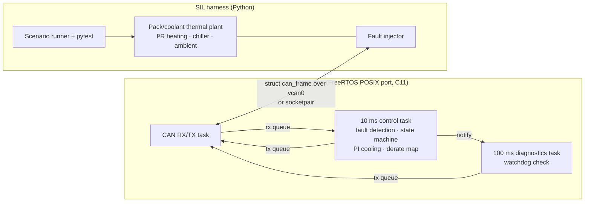

# Battery Fast-Charge Thermal Controller (SIL)

Embedded C11 controller on FreeRTOS that keeps a battery pack in its temperature window during DC fast charge, detects sensor and CAN faults, and is verified software-in-the-loop against a Python thermal plant over DBC-defined CAN — for vehicle controls and test engineers who need to prove ECU behaviour before HIL.

## Results

- **All 10 injected faults caught in 10–130 ms**, inside the 200 ms fault-tolerant time interval (stuck/open/shorted/spiking sensors, implausible redundancy, frame loss, bad CRC, frozen alive counter).
- **Peak cell temperature held at 36.4 °C or below** in 10→80 % fast charges at 25 and 35 °C ambient (limit 50 °C), with 0 false trips across all three ambient runs.
- **C CAN codec matched cantools on all 31 DBC signals** across random, edge and physical-value round trips.
- **47 Unity unit tests at 91.5 % branch coverage** (gcov) over the controller, fault-detection, E2E and state-machine modules.


**Stack:** C11, FreeRTOS (POSIX/Linux port), CAN / SocketCAN, DBC, Python, cantools, python-can, NumPy, Matplotlib, pytest, Unity, gcov, GNU Make, GitHub Actions

## Quickstart

```bash
python3 -m venv .venv && .venv/bin/pip install -r requirements.txt
make -C firmware test                       # Unity unit tests + branch coverage
.venv/bin/python scripts/run_scenarios.py   # fast-charge + fault SIL runs -> docs/results.md, docs/sil_results.png
```

## How it works



- **Controller library** (`firmware/src/`, no dynamic allocation, all state in fixed structs):
  `pi_ctrl` (PI with clamping + conditional-integration anti-windup), `filter` (low-pass, slew limiter),
  `derate` (temperature → current map with a 2 °C play-operator hysteresis), `fault_detect`
  (debounced range, stuck-at, rate-of-change, redundant plausibility), `e2e` (CRC-8 SAE J1850 with
  data ID, 4-bit alive counter, timeout), `state_machine`, `can_codec` (table-driven pack/unpack of
  the DBC) and `bms_core`, which wires them together and has no RTOS dependency.
- **FreeRTOS application** (`firmware/app/`): statically allocated tasks and queues. A CAN task
  moves frames between the transport and queues; the control task runs every 10 ms; the
  diagnostics task runs every 100 ms, checks that the control and CAN tasks made progress
  (watchdog) and sends `BMS_FaultStatus`.
- **Lockstep co-simulation**: the plant sends `PLANT_CellTemps`, `PLANT_PackStatus` and a
  `SIL_Sync` frame per 10 ms step; the controller runs one cycle per `SIL_Sync` and answers with
  `BMS_ChargeRequest` and `BMS_ThermalCmd`. Simulated time is therefore deterministic and a
  31-minute charge runs in about 20 s. `bms_app --realtime` instead releases the control task
  from the FreeRTOS tick with `vTaskDelayUntil`.
- **Transports**: SocketCAN raw socket on `vcan0` (`--can vcan0`) or an `AF_UNIX`
  `SOCK_SEQPACKET` socketpair carrying the same 16-byte `struct can_frame` (`--fd N`). The SIL
  suite uses the socketpair by default, so it runs where the `vcan` module is missing.
  To use vcan: `sudo modprobe vcan && sudo ip link add dev vcan0 type vcan && sudo ip link set up vcan0`.
- **Plant** (`sil/bmssil/plant.py`): two thermal masses (350 kJ/K cells, 18 kJ/K coolant),
  pump-dependent cell-to-coolant conductance (150–600 W/K), 60 mΩ pack resistance, 7 kW chiller
  with low-coolant cut-off, ambient losses, seeded sensor noise and a CC-taper fast charger
  (300 A to 50 % SOC, tapering to 120 A at 80 %).

## Full results

Generated by `scripts/run_scenarios.py` (also written to `sil/out/results.md` by the pytest suite).

| Scenario | Peak cell (°C) | Overshoot (°C) | Settling (s) | Charge 10→80 % (min) | Max state | Fault flags set |
|---|---|---|---|---|---|---|
| fast_charge_25C | 36.2 | 1.21 | 629 | 30.9 | NORMAL | 0 |
| fast_charge_35C | 36.4 | 1.38 | 0 | 30.9 | NORMAL | 0 |
| fast_charge_45C | 45.0 | 0.04 | 1205 | 32.8 | DERATE | 0 |

Overshoot is measured above max(setpoint 35 °C, starting temperature). Settling is the time until
the cell temperature enters 35 ± 1.5 °C and stays there while charging; the 45 °C pack starts
soaked at ambient, so its value is the pull-down time, during which the thermal DERATE state
limits current to about 205 A.

| Injected fault | Expected reaction | First reaction | Latency (ms) | FTTI (ms) | Final state |
|---|---|---|---|---|---|
| sensor_a_stuck | DERATE | DERATE | 130 | 200 | DERATE |
| sensor_a_open | DERATE | DERATE | 20 | 200 | DERATE |
| sensor_a_short | DERATE | DERATE | 20 | 200 | DERATE |
| sensor_a_spike | DERATE | DERATE | 10 | 200 | DERATE |
| sensor_ab_implausible | LIMP | LIMP | 40 | 200 | LIMP |
| sensor_both_open | SAFE_STATE | SAFE_STATE | 20 | 200 | SAFE_STATE |
| temps_frame_drop | SAFE_STATE | SAFE_STATE | 100 | 200 | SAFE_STATE |
| pack_frame_drop | LIMP | LIMP | 100 | 200 | LIMP |
| crc_corrupt | LIMP | LIMP | 80 | 200 | LIMP |
| alive_frozen | LIMP | LIMP | 20 | 200 | SAFE_STATE |

`alive_frozen` first reaches LIMP (alive-counter error) and then SAFE_STATE, because frames with a
frozen counter are rejected and the cell-temperature timeout follows.

Branch coverage from `make -C firmware test`:

| Module | Lines % | Branches % |
|---|---|---|
| bms_core.c | 99.3 | 82.1 |
| can_codec.c | 100.0 | 95.8 |
| derate.c | 100.0 | 100.0 |
| e2e.c | 100.0 | 100.0 |
| fault_detect.c | 100.0 | 95.5 |
| filter.c | 100.0 | 100.0 |
| pi_ctrl.c | 100.0 | 83.3 |
| state_machine.c | 100.0 | 100.0 |
| **Total** | **99.8** | **91.5** |

## Requirement traceability

Safety goals, the fault-reaction table and the full matrix are in
[docs/safety_requirements.md](docs/safety_requirements.md). Summary:

| Req ID | What | Tests |
|---|---|---|
| REQ-THM-01..04 | Peak temperature, overshoot, settling, bounded/slew-limited PI | `sil/test_closed_loop.py`, `firmware/tests/test_filter_pi.c` |
| REQ-CHG-01..02 | Derate map with hysteresis, charge time | `firmware/tests/test_derate.c`, `sil/test_closed_loop.py` |
| REQ-FD-01..04 | Range, stuck-at, rate-of-change, plausibility | `firmware/tests/test_fault_detect.c`, `test_bms_core.c`, `sil/test_faults.py` |
| REQ-E2E-01..03 | CRC-8, alive counter, timeout | `firmware/tests/test_e2e.c`, `test_bms_core.c`, `sil/test_faults.py`, `sil/test_dbc_codec.py` |
| REQ-SM-01..02 | State machine, latching, safe-state outputs | `firmware/tests/test_state_machine.c`, `test_bms_core.c`, `sil/test_faults.py` |
| REQ-SAF-01..03 | Reaction within FTTI, no false trips, watchdog reaction | `sil/test_faults.py`, `sil/test_closed_loop.py`, `test_bms_core.c` |
| REQ-CAN-01..02 | DBC codec vs cantools, transport determinism | `sil/test_dbc_codec.py`, `firmware/tests/test_can_codec.c`, `sil/test_transport.py` |

## Running the tests

```bash
make -C firmware test        # 47 Unity tests, gcov branch report, fails below 80 % per module
python3 -m pytest sil -q     # builds bms_app, runs 3 fast charges + 10 fault scenarios (~1 min)
```

`sil/conftest.py` falls back to the packages in `.venv/` when the interpreter running pytest
lacks cantools. The GitHub Actions workflow (`.github/workflows/ci.yml`) runs both suites and
tries to bring up `vcan0` first.

## Design notes

- **Fused temperature = max of the two healthy sensors**, so the controller errs hot. A sample
  that fails the range or rate check is excluded immediately, before its debounce qualifies,
  so one open-circuit reading (369.5 °C) cannot reach the filter and trip the overtemperature monitor.
- **Fault reactions latch, thermal derate does not.** A sensor fault is a property of the
  hardware for the drive cycle; a hot pack is an operating condition that recovers with 45/43 °C hysteresis.
- **E2E errors are debounced per message** (+2 per bad frame, −1 per good, limit 6). A shared
  counter let good `PackStatus` frames mask a 50 % CRC error rate on `CellTemps`, which the SIL
  run exposed.
- **Stuck-at detection relies on sensor noise**: 15 identical 12-bit raw samples in a row. The
  plant's 0.2 °C noise makes that practically impossible for a live sensor, and the
  noise-free coolant channel is excluded from the stuck check.
- **The 32-bit SIL step counter overflowed float precision** in the physical-value encoder; the
  cantools cross-check caught it, and `can_signal_set` now takes a `double`.

## Third-party code

- [FreeRTOS-Kernel](https://github.com/FreeRTOS/FreeRTOS-Kernel) V11.1.0 (MIT): kernel and the
  POSIX port are vendored in `firmware/third_party/FreeRTOS-Kernel/` with their license.
- [Unity](https://github.com/ThrowTheSwitch/Unity) v2.6.0 (MIT): vendored in `firmware/third_party/unity/`.

## Limitations and next steps

- **No vcan in this environment.** The kernel here has no `vcan` module, so every reported
  result ran over the socketpair transport, and the vcan-vs-socketpair trace comparison was
  skipped. The vcan path (`--can vcan0`, python-can) is implemented but was not exercised here.
  Next: run the suite where `vcan` is available (the CI workflow tries to load it).
- **Real-time mode is not under test.** `bms_app --realtime` (tick-driven `vTaskDelayUntil`)
  builds, but every SIL test uses lockstep, so the results say nothing about scheduling jitter
  on a loaded host.
- **The watchdog is only covered at its reaction.** The progress check in the diagnostics
  task has no test that stalls a task; unit tests cover only the SAFE_STATE reaction to a
  reported watchdog fault. Next: a firmware test hook that stalls the control task in SIL.
- **Lumped thermal model.** It has one cell mass and one coolant mass, no cell-to-cell gradient, no
  electrochemical or ageing behaviour, and order-of-magnitude parameters, not identified ones.
  The 45 °C case shows the chiller is the binding constraint at high ambient.
- **Two modules sit below 85 % branch coverage**, `bms_core.c` (82 %) and `pi_ctrl.c` (83 %).
  The gate is set at 80 %.
- **Safety concept only.** The requirements follow the spirit of ISO 26262, but there is no HARA,
  ASIL allocation or independent review, and no claim of compliance.
- **No HIL or real CAN hardware**, and no CAN FD or bus-load modelling.
